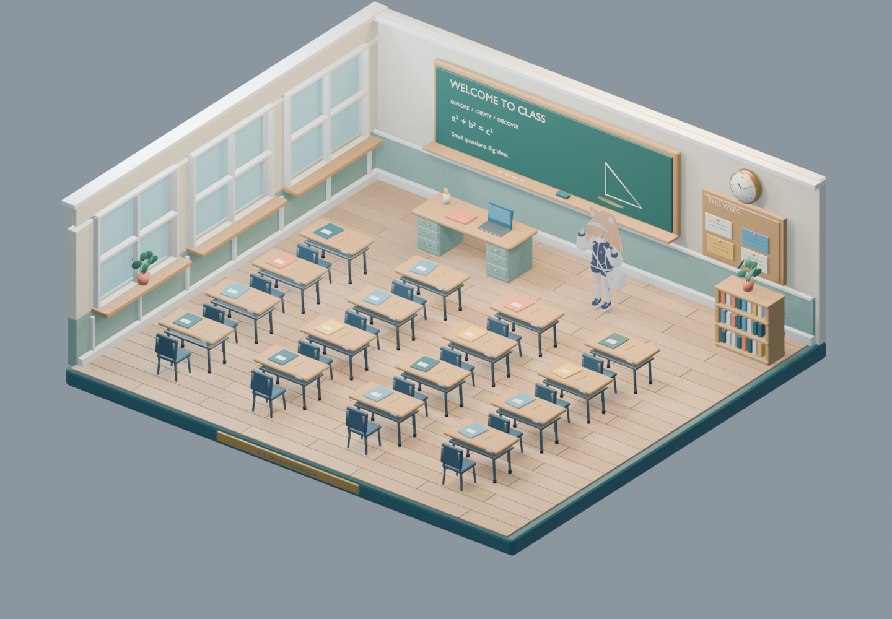
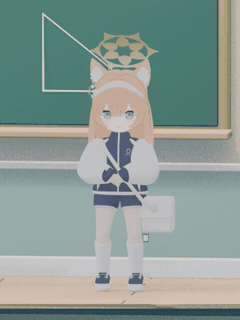
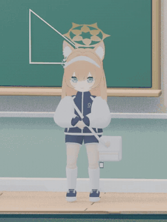
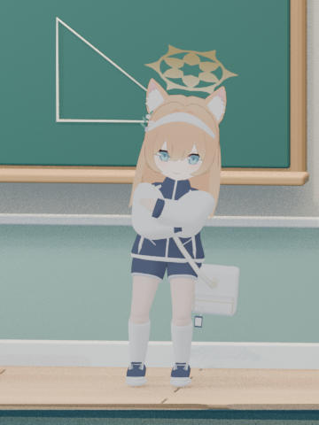
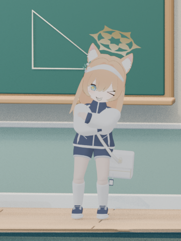
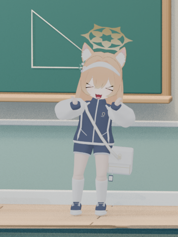
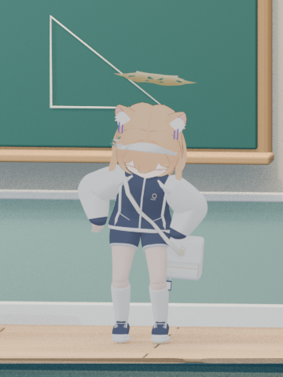

# Mari Classroom · Blender

A classroom diorama with a rigged chibi character in a sports outfit, two versions of a **10-second 2 Phut Hon inspired dance**, and **nine keyboard-controlled emotes**. Built and checked in **Blender 5.2.2 LTS**.



**Start with [Classroom-emotes.blend](classroom/deliverables/Classroom-emotes.blend)** for the current character, both dances, and all emotes. The [original dance scene](classroom/deliverables/Classroom-dance.blend) is preserved separately.

## Watch the animations

The animated previews below loop automatically. Click a preview or an MP4 link to open/download the full **24 fps** video. All videos are silent.

| Refined 2 Phut Hon dance · 10 seconds | Paw dance emote · 6 seconds |
| --- | --- |
| [](classroom/deliverables/Classroom-dance-fluid-10s.mp4?raw=1) | [](classroom/deliverables/Emote-paws-fluid-6s.mp4?raw=1) |
| [Open / download dance MP4](classroom/deliverables/Classroom-dance-fluid-10s.mp4?raw=1) | [Open / download paw emote MP4](classroom/deliverables/Emote-paws-fluid-6s.mp4?raw=1) |

Also available: [original 2 Phut Hon dance MP4](classroom/deliverables/Classroom-dance-10s.mp4?raw=1), [dance pose sequence](classroom/deliverables/previews/fluid-dance-contact.jpg), and [paw dance pose sequence](classroom/deliverables/previews/fluid-paws-contact.jpg).

## Character and expressions

The character has a 49-bone full-body rig, finger and toe controls, facial expressions, blinking, and animated hair, ears, halo, and bag. The revised motion adds weight shifts, softer knees, staggered gestures, and secondary motion. Switching animations eases from the current pose over eight frames (about 0.3 seconds).

| Crossed-arm sass · Numpad 1 | Cheeky wink · Numpad 5 | Paw dance · Numpad 6 | Dejected bow · Numpad 9 |
| --- | --- | --- | --- |
|  |  |  |  |

[Browse all current pose previews](classroom/deliverables/previews/fluid/).

## Open and play

1. Clone the project, including its pinned MCP dependency:

   ```sh
   git clone --recurse-submodules https://github.com/brianlyj/blender-proj.git
   cd blender-proj
   ```

2. In Blender 5.2, open **Preferences → Add-ons → Install from Disk**, select [mari_emote_controls.py](classroom/deliverables/mari_emote_controls.py), and enable **Mari Emote Numpad Controls**.
3. Open [Classroom-emotes.blend](classroom/deliverables/Classroom-emotes.blend). Character textures are packed into the scene.
4. Turn **Num Lock on**, move the pointer over the **3D viewport**, and press **Numpad +** to play the refined dance. The viewport's **N sidebar → Emotes** tab provides the same controls as buttons.

The companion controller is needed for keyboard switching. Blender MCP is used for scripted scene editing; playback works without a running MCP connection. The controller is also embedded as a text block for inspection, and the scene does not require automatic execution of embedded scripts.

## Numpad controls

| Key | Animation or control |
| --- | --- |
| **+** | Refined 2 Phut Hon dance — 10 seconds |
| **−** | Original 2 Phut Hon dance — 10 seconds |
| **1** | Crossed-arm sass |
| **2** | Happy bounce |
| **3** | Cheerful twirl |
| **4** | Deal with it — pixel sunglasses |
| **5** | Cheeky wink |
| **6** | Paw dance |
| **7** | Shy hand clasp |
| **8** | Double point |
| **9** | Dejected bow |
| **0** or the current animation's key | Ease back to idle |
| **Enter** | Pause/resume; from idle, replay the previous animation |
| **.** | Enable/disable emote shortcuts to restore Blender's normal numpad view controls |

Emotes loop for six seconds at 24 fps. Both dances run for 240 frames at 24 fps. Shortcuts apply in the 3D viewport of a scene containing the emote pack. See the [full control guide](classroom/deliverables/EMOTE-CONTROLS.txt) for details.

## Project files

| Location | Contents |
| --- | --- |
| [classroom/deliverables](classroom/deliverables/) | Current and original Blender scenes, MP4 videos, controller, previews, and asset credit |
| [classroom/scripts](classroom/scripts/) | Scene creation, character refinement, animation, rendering, and validation scripts |
| [classroom/references](classroom/references/) | Source model and visual references |
| [classroom/reports](classroom/reports/) | Animation checks, live control checks, and organization records |
| [classroom/archive](classroom/archive/) | Earlier scenes and historical previews |
| [docs/media](docs/media/) | Compact animated previews for this README |
| [server-source](server-source/) | Official Blender MCP source, pinned as a Git submodule |

New rendered frame sequences, local checkpoints, Blender backup files, and diagnostic logs are ignored by Git. The final scenes, videos, previews, scripts, and validation reports are included. Previously committed historical files remain in the repository.

## Edit and render

Select **MARI \| refined character rig** and enter Pose Mode to adjust the character. In the Action Editor, revised emotes use names beginning with `EMOTE 0` through `EMOTE 9` and ending with `fluid`. The dance actions are `DANCE | 2 Phut Hon - fluid` and `DANCE | 2 Phut Hon | ORIGINAL`.

From the repository root, render the current dance and paw emote previews with:

```sh
cd classroom
blender --background deliverables/Classroom-emotes.blend --python scripts/render/render_fluid_preview.py
```

Use your Blender executable's full path if `blender` is not on PATH. The script writes PNG sequences to `renders/fluid-dance/` and `renders/fluid-paws/`, skipping frames that already exist. For a fresh render after animation edits, move the previous sequence to an archive folder first.

Encode the rendered sequences with FFmpeg:

```sh
ffmpeg -framerate 24 -i renders/fluid-dance/frame_%03d.png -c:v libx264 -crf 20 -pix_fmt yuv420p -movflags +faststart deliverables/Classroom-dance-fluid-10s.mp4
ffmpeg -framerate 24 -i renders/fluid-paws/frame_%03d.png -c:v libx264 -crf 20 -pix_fmt yuv420p -movflags +faststart deliverables/Emote-paws-fluid-6s.mp4
```

Build and refinement scripts can modify or save the scene. Use a working copy when revisiting historical editing steps. See [classroom/README.txt](classroom/README.txt) for the original dance workflow and project organization details.

## Validation

The saved [motion validation report](classroom/reports/final/fluid-motion-validation.json) covers all 12 actions, loop endpoints, six transition pairs, expression drivers, and shortcut behavior. The [live Blender check](classroom/reports/final/fluid-live-check.json) confirms that transitions finish, idle stops playback, and Enter pauses/resumes. The [build report](classroom/reports/final/fluid-motion-build.json) records preservation of the original dance file and bone animation.

## Git and the MCP dependency

`server-source/` points to the official [Blender MCP repository](https://projects.blender.org/lab/blender_mcp.git) at **v1.0.3**, commit `2cea8d566dde07fbac28a61d698909d69724e853`.

After cloning without submodules, or after pulling a dependency change:

```sh
git submodule update --init --recursive
```

The parent repository records the pinned commit; the upstream server source stays in its own repository. See [GIT-WORKFLOW.txt](GIT-WORKFLOW.txt) for pushing changes and intentionally upgrading the dependency.

## Credits and references

The character adapts elements from **[Blue Archive] -Mari (Idol)- | Chibi + Stage** by **VuckyZ / VückyZ**, supplied with **Creative Commons Attribution 4.0** metadata. Adapted elements include the face, eyes, eyebrows, mouth, hair, ears, and halo. The sports outfit, accessories, rig, and animations were rebuilt or revised for this scene.

- [Source asset and author](https://sketchfab.com/3d-models/blue-archive-mari-idol-chibi-stage-7412827541324d13a557d2f4a7f8d3c4)
- [CC BY 4.0](https://creativecommons.org/licenses/by/4.0/)
- [Detailed asset credit and modifications](classroom/deliverables/ASSET-CREDIT.txt)
- [Emote reference reel](https://www.facebook.com/reel/952944630756734/)

The animations are hand-authored interpretations of the references. The reel's character, outfit, and audio were not imported.
